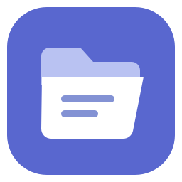
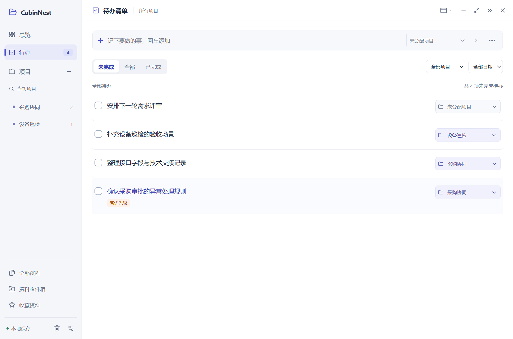
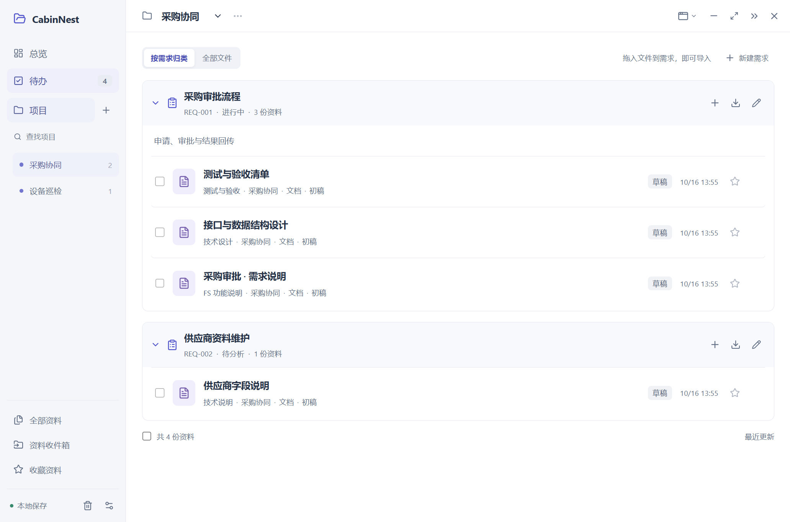

<p align="center"></p>

# CabinNest

一个轻巧的 Windows 本地项目资料与待办管理工具。按「项目 → 需求 → 多份文件」整理资料，把说明书、技术文档、交接记录与待办放在一起。

[查看 GitHub 已发布版本](https://github.com/LQB9/CabinNest/releases/latest) · [更新记录](CHANGELOG.md) · [使用说明](使用说明.txt)



## 主要功能

- **按需求整理文件**：同一需求可关联多份 Word、Excel、PDF、图片及技术笔记，支持从资源管理器直接拖入。
- **展开状态记忆**：支持全部展开、全部折叠与逐项调整，各项目分别记住状态，重新进入或重启后保留。
- **清楚的类型标签**：FS 功能说明与技术文档采用不同颜色的圆点及文字，点击标签即可修改分类；同一需求内优先排列 FS 与技术资料。
- **简洁的资料列表**：需求分组与文件层级清楚，窄窗口保留文件名、版本和时间；总览采用轻量统计条。
- **统一待办**：待办与项目同级，打开即可查看跨项目的未完成事项，每条待办可直接选择所属项目。
- **轻量总览**：查看项目、未完成、已完成及逾期事项数量，点击进入对应列表。
- **三种使用方式**：独立窗口、侧边面板、托盘弹窗，均支持最小化与收起。
- **自动贴边入口**：轻巧的文件夹浮签，支持左、右和顶部贴靠，记住位置，点击恢复原使用方式；默认闲置 5 秒后淡化，移入恢复，可在设置中调整。
- **文档与版本**：应用内笔记自动保存，支持历史快照、DOCX 预览与外部编辑后收回；Excel、PPT 等通过默认软件打开。
- **文件快捷操作**：文件行右键可改显示名称、调整需求、上传新版本或移入回收站；拖入同名新内容时选择更新版本、另存或跳过，历史版本保留。
- **文件与项目导出**：文件行右键导出单份文件，笔记可导出为 Word；项目右键可导出完整项目归档并重新导入。
- **本地备份**：支持完整备份与恢复，也可配置后台自动备份的目录、频率和保留份数，查看最近成功状态。



截图使用虚构示例项目，下载包首次启动为空资料库。

## 下载与使用

1. 使用 Windows x64 MSI 安装包，按向导安装后，从桌面或开始菜单打开 CabinNest。Windows“已安装的应用”中提供卸载入口。
2. 安装版程序与资料分开保存，升级和卸载会保留资料。GitHub 旧版本若提供 ZIP，则属于便携版，按其版本说明使用。
3. 新建项目和需求，将文件拖到需求区域；在「待办」中记录事项并选择所属项目。

安装包和便携包均不包含演示数据或个人资料。全新安装首次启动为空资料库，已有资料迁移后继续保留。

### 文件与备份

安装版业务数据位于 `%USERPROFILE%/CabinNest/data`，包括数据库、附件、历史版本和外部编辑副本；程序位于 `%LOCALAPPDATA%/Programs/CabinNest`。固定资料目录避免 Windows 对 AppData 的应用沙箱重定向导致不同启动方式读到不同的库。便携版使用程序旁的 `data` 文件夹。请在「备份与设置」查看实际资料目录，换机时通过完整备份恢复，更新前先备份资料。

v1.16.1 首次启动时，会校验并复制 v1.16.0 的旧资料库，包括已知开发工具沙箱中的 CabinNest 目录；原库保留。空库不会优先于有资料的旧库，多份不同的有效旧库会停止自动迁移并提示处理。固定目录已建立资料库后，后续启动不会再从旧目录覆盖它。

导入文件会复制一份到资料库，原文件保持不变。外部编辑后，需要先保存并在应用内「收回编辑」，再导出最新版本。

在「备份与设置 → 自动备份」选择应用 `data` 目录以外的位置，设置频率和保留份数并启用。应用运行时，有变化且达到间隔才自动创建完整备份；也可立即备份。备份在后台执行，保留数量只影响本应用创建的自动备份，手动备份继续保留。完全退出前会检查并补备份未备份的修改；退出后不执行定时任务。失败时可重试、返回应用或仍然退出，同一问题只提醒一次。设置页显示最近备份的项目、需求、资料、待办数量、备份数据大小、压缩节省空间和下次检查时间。自动备份对可节省空间的文件无损压缩，每份均可独立恢复；仍兼容旧备份。云端上传由同步客户端完成，本应用的成功状态仅表示备份已生成。

右键左侧项目可导出项目归档。归档可以保存到 Google 云端硬盘客户端的同步目录，也可以手动上传；应用目前不直接连接云盘账号，归档为导出时点的快照。

### 常用操作

| 操作 | 入口 |
| --- | --- |
| 全局搜索 | `Ctrl K` 或「全部资料」 |
| 新建资料 / 导入资料 | `Ctrl N` / `Ctrl O` |
| 保存正文 | `Ctrl S` |
| 导出单份文件 | 文件行右键或行尾 `⋯` |
| 导出项目归档 | 左侧项目右键 |
| 全部展开 / 全部折叠 | 项目内「按需求归类」右上方，窄窗口中点击 `⋯` |
| 悬浮入口淡化设置 | 备份与设置 → 悬浮入口 |
| 切换窗口方式 / 完全退出 | 右上角窗口菜单，或托盘菜单 |

DOCX 预览适合常见文字、图片和表格；复杂排版、宏及嵌入对象需在原软件中查看。扫描 PDF 暂不提供 OCR。当前版本面向 Windows x64。

## 开发与构建

技术栈：Electron、React、Tiptap、SQLite。开发环境需要 Node.js 24 或以上与 pnpm；使用发布包无需另装 Node.js 或服务端。

```powershell
git clone https://github.com/LQB9/CabinNest.git
cd CabinNest
pnpm install --frozen-lockfile
node node_modules/electron/install.js
pnpm build
pnpm test
pnpm start
```

生成 Windows 便携程序：

```powershell
pnpm package
```

输出目录为 `release/CabinNest-win32-x64`。先执行 `pnpm build` 再打包。

后端测试覆盖文档、需求归属、项目归档、备份恢复与贴边位置。桌面流程测试位于 `tests/`，需要另装 Playwright；可设置 `PROJECTDESK_PLAYWRIGHT_MODULE` 指向已有模块目录。

`PROJECTDESK_DATA_DIR` 可指定独立测试资料库，`PROJECTDESK_TEST=1` 用于界面自动化。保留 `PROJECTDESK_*` 环境变量和旧版数据库标识，以兼容已有数据；正式使用无需设置这些变量。

## 许可

本项目目前标记为 `UNLICENSED`，尚未授予开源使用许可。第三方组件遵循各自许可，详见 [THIRD_PARTY_NOTICES.txt](THIRD_PARTY_NOTICES.txt) 及发布包中的 Electron / Chromium 许可文件。

### 标准安装与结项项目

安装包为 Windows x64 MSI，可通过安装向导安装，在桌面、开始菜单和 Windows 已安装的应用中管理。默认程序目录为 `%LOCALAPPDATA%/Programs/CabinNest`，资料目录为 `%USERPROFILE%/CabinNest/data`；升级、修复和卸载仅管理程序，资料保留。便携版本仍使用程序旁的 data 目录。

项目右键 → 结项归档 → 选择云盘同步根目录，应用在其“历史项目”子目录生成并校验独立归档。确认云盘完成上传后，可输入完整项目名，将项目从本机资料库移出。历史归档不受自动备份轮换清理影响；移出前在本机保留完整恢复备份。

在“备份与设置 → 历史项目”可以打开归档、恢复为新项目或稍后移出本机资料库。归档后若项目有新修改，必须重新归档才能移出。未保存到磁盘的外部 Word/Excel 内容无法归档，请先保存并收回编辑。

开发打包：先构建和生成 Windows 目录包，再执行 `pwsh -File scripts/build-msi.ps1`，使用 Windows 自带的 Installer COM 与 MakeCab 生成 MSI，无第三方安装编译器依赖。
